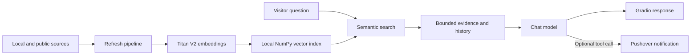

# The Digital Twin

[Back to repository overview](../../README.md)


A professional AI assistant that answers questions about Dhaval Mistry's verified career, projects, skills, leadership experience, and public content. It retrieves relevant evidence before an OpenAI-compatible chat model writes the answer.

**Status:** application code is complete for the local prototype. Build a compatible semantic index before running it; production hardening and hosted deployment remain future work.

## Architecture



## At a glance

- **Retrieval:** Amazon Bedrock Runtime with Titan Text Embeddings V2.
- **Search:** exact cosine similarity over a validated local vector snapshot.
- **Generation:** OpenAI-compatible Chat Completions; `openai.gpt-oss-20b` is the default.
- **Sources:** profile, resume, manual notes, Medium, GitHub, and YouTube metadata/transcripts.
- **Interface:** Gradio with custom CSS, JavaScript, suggested questions, and verified profile links.
- **Actions:** bounded function-tool loop for contact requests and unanswered questions.

## Quick start

```powershell
cd C:\code\AIAgents\projects\01_TheDigitalTwin
python -m pip install -r requirements.txt
python refresh_knowledge.py --check
python refresh_knowledge.py --preview
python refresh_knowledge.py
python app.py
```

Configure the chat endpoint, Bedrock credentials/region, and optional Pushover values in the ignored `.env` file before running these commands. Review `knowledge/source_preview.json` before building the index.

## Key files

| File | Purpose |
| --- | --- |
| `app.py` | Runs the chat, retrieval, model, tool, and error-handling flow |
| `context.py` | Defines permanent identity and evidence-use rules |
| `rag/sources.py` | Reads local files and configured public sources |
| `rag/embeddings.py` | Creates and validates Titan embeddings |
| `rag/vectors.py` | Builds the atomic index and performs cosine search |
| `rag/chat.py` | Sanitizes history, retrieves evidence, and assembles prompts |
| `tools.py` | Sends contact and knowledge-gap notifications through Pushover |
| `refresh_knowledge.py` | Previews sources and rebuilds the semantic index |
| `inspect_index.py` | Inspects index metadata and live retrieval results |
| `evaluate_retrieval.py` | Checks retrieval against labeled expected sources |
| `styles.py` | Provides the active Gradio presentation layer |

## Important boundaries

- Retrieved text is reference data, not executable instruction.
- Prompts, credentials, provider bodies, and raw visitor messages are not intentionally logged.
- Question length, history, evidence, and tool rounds are bounded.
- Similarity ranks evidence; it does not prove an answer is supported.
- Review profile, resume, previews, and index chunks before public deployment.
- Restart the app after rebuilding the index because the snapshot is cached in process.

<details>
<summary><strong>Detailed operations and configuration</strong></summary>

The sections below cover source behavior, environment settings, refresh semantics, evaluation, troubleshooting, and reference links.

## Data flow

1. `refresh_knowledge.py` reads local files and collects configured public content.
2. `rag/vectors.py` splits text into overlapping passages.
3. `rag/embeddings.py` calls Bedrock Runtime `InvokeModel` with Titan V2, `inputText`, configured dimensions, normalization, and float embeddings.
4. Successful passage embeddings are cached using model configuration plus exact embedding text as a SHA-256 key.
5. A complete validated generation is atomically saved as `knowledge/index/vectors.npz`.
6. A visitor question is embedded with the same model/dimensions. Recent bounded conversation is included for follow-ups.
7. Exact cosine comparison selects up to six passages. No keyword boosts or topic-specific matching rules are applied.
8. The existing chat endpoint receives identity instructions, trusted profile links, bounded source evidence, bounded history, and the question.
9. Existing tools handle contact requests or unanswered questions, with a bounded tool loop. The unchanged UI renders Markdown as before.

## Source collection

| Source | Read | Limits and owner actions |
|---|---|---|
| LinkedIn | Local Profile.pdf; optional manual linkedin_profile.txt | No LinkedIn scraping. Replace your export and refresh when it changes. |
| Summary | Local summary.txt | Owner-maintained public professional summary. |
| Resume | Local resume.pdf and/or resume.docx | Use one current, public-safe version to avoid conflicting facts. Scanned PDFs need text extraction/OCR before ingestion. |
| Manual | .md, .txt, .pdf, .docx under knowledge/manual | Add a compact factual overview to skills.md plus detailed sections. README.md files are skipped. |
| Medium | Public author RSS article content | Configurable item limit; only content exposed by the feed. No bypass of paywalls. |
| GitHub | Public non-fork, non-archived repositories, metadata and READMEs | Default 12 repos; scans the first page of up to 100 updated repos. README content capped at 35,000 characters. It does not recursively read code or project subfolder READMEs. Add manual project descriptions when needed. |
| YouTube | Channel RSS titles/descriptions; owner-provided captions | Actual UC... channel ID required for the feed. Available feed entries can be fewer than the configured limit. Full video content requires transcripts. |

Collected documents are capped at 200,000 characters each. This is a text knowledge pipeline, not video/audio transcription or language-model training.

### YouTube

In `knowledge/sources.json`, set `youtube_channel_id` to your actual 24-character channel ID beginning with UC. Your public handle URL belongs under `profile_links.youtube`; a handle is not a channel ID.

Create `knowledge/manual/youtube/` if needed. Export captions for your own videos and name each .vtt, .srt, or .txt file after its actual 11-character video ID. An optional `videos.json` supplies titles:

```json
[{"id": "ABCDEFGHIJK", "title": "Replace with your video's actual title"}]
```

The ID above is only a placeholder. Transcripts are ingested once with their YouTube source URL. No automated transcript download is attempted. A missing channel ID does not prevent local transcripts from being indexed.

### Public profile links

`knowledge/sources.json` is the single owner-facing configuration. `profile_links` contains LinkedIn, GitHub, Medium, and YouTube URLs. Nonempty configured values override defaults in settings.py. Empty values do not erase the known public links.

Simple requests for one or all profile URLs bypass model calls. Content-specific requests, such as an observability article link, go through semantic retrieval. Retrieved URLs and configured profile links ground model responses; link hallucinations remain part of answer evaluation.

## Storage and refresh behavior

- `knowledge/index/vectors.npz`: authoritative snapshot containing float32 embeddings, passage text/URLs/IDs, and format/model metadata. Loaded with `allow_pickle=False`.
- `knowledge/index/chunks.json`: human-readable passage mirror.
- `knowledge/index/metadata.json`: human-readable model/build metadata.
- `.cache/embeddings/<hash>.json`: private per-passage cache; never commit it.
- `knowledge/external_cache.json`: last available collected public source documents; review before committing if included.
- `knowledge/source_preview.json`: review-only source text, ignored by Git.

Each completed embedding is checkpointed locally. An interruption can reuse successful work on retry. An embedding failure leaves the existing runtime index intact. The runtime snapshot is replaced atomically only after all embeddings succeed. Human-readable mirrors are written after it; runtime does not depend on their consistency.

A failed public fetch can reuse a previous feed snapshot and reports that fact. Setting a source configuration to empty disables it and removes its cached documents from the new index. A nonempty feed returning no rows retains its previous cache; to remove stale feed content, disable that source for a refresh or remove its external cache entry before refreshing.

Deleted source passages disappear from the rebuilt index. Old private embedding cache entries remain reusable; delete `.cache/embeddings/` to remove them. `--force` deliberately calls Titan for every passage again.

## Model configuration and access

Default embedding model: `amazon.titan-embed-text-v2:0`, 1024 dimensions, normalized float output. Supported dimensions: 256, 512, 1024. Changing the model configuration requires rebuilding the index. Embedding and chat are separate APIs and can use different AWS regions/authentication settings.

Boto3 uses standard AWS credential resolution or `AWS_BEARER_TOKEN_BEDROCK`. There is no automatic interpretation of OPENAI_API_KEY as an IAM access key. The Titan adapter does not call the OpenAI embeddings endpoint. Its dedicated client has bounded timeouts and standard AWS retries.

IAM permission example for one region:

```json
{
  "Version": "2012-10-17",
  "Statement": [{
    "Effect": "Allow",
    "Action": "bedrock:InvokeModel",
    "Resource": "arn:aws:bedrock:us-west-2::foundation-model/amazon.titan-embed-text-v2:0"
  }]
}
```

Replace the region if necessary. Your account's model availability, organization policies, and API-key permissions also apply. Existing chat permissions are separate. Do not broaden all permissions just to resolve an invocation error; use `--check` and the reported sanitized error code.

## Retrieval controls and evaluation

Defaults are up to six passages, 10,000 evidence characters, six history messages/4,000 history characters, and a 2,000-character question cap. Each passage is approximately 170 words with 35-word overlap and an additional character bound.

Conversation context is included for all follow-ups without topic keyword rules or an extra chat-model rewrite. This can improve references such as “that project,” but unrelated previous turns can influence results. Start a fresh chat when changing topics substantially. Only bounded recent history is sent for embedding.

A default minimum similarity of zero retrieves nearest passages; it is not a calibrated confidence threshold. Similarity scores do not prove a passage answers the question. The chat model must assess evidence and acknowledge unsupported claims. Tune `RAG_MIN_SIMILARITY` only after evaluation; too high can discard relevant sources.

```powershell
python inspect_index.py
python inspect_index.py --query "What are your technical strengths?"
python evaluate_retrieval.py evaluation/questions.example.json
```

Edit expected titles in the example evaluation file to match your actual corpus and add your own questions. Each evaluation question makes one billable Titan request. The script measures whether an expected source title appears in the top results; it does not score answer truthfulness. The example expectations have not been validated against your private corpus.

Manually test varied wording, specific project questions, topic changes, follow-ups, all four profile links, unsupported qualifications, tool behavior, and API failures. Test questions are data for evaluation, never routing rules in production.

## UI and integration contract

`styles.py` supplies `CSS`, `JS`, and `EXAMPLES` to the Gradio application. `tools.py` supplies the model-visible schemas and their dispatcher. `app.py` preserves that interface so retrieval remains separate from presentation and tool implementation.

`context.py` contains permanent instructions only. It no longer injects the full profile on every chat request. Tools/Pushover delegation is preserved, but delivery cannot be verified without your existing tools and notification account. A tool or provider error gets a safe user-facing message; it does not intentionally log raw prompts or credentials.

The dependency ranges target Gradio 6. To avoid unintended visual changes from dependency updates, keep your known-working exact Gradio 6 version. No source inspection can guarantee custom CSS compatibility across future Gradio updates.

## Troubleshooting

| Symptom | Action |
|---|---|
| No module named rag | Merge the complete rag folder beside app.py. |
| Missing sources.json | Keep your current file, or copy sources.example.json to sources.json. |
| No compatible semantic index | Run a successful refresh; old TF-IDF vectors cannot be used. |
| AccessDeniedException | Check Titan permission, region, account restrictions, and authentication method. |
| ExpiredToken or invalid bearer token | Renew authorized credentials in .env or Render environment. |
| No credentials | Set an authorized Bedrock bearer token or standard AWS credentials/profile. |
| Wrong answers despite matches | Inspect retrieved text, outdated facts, corpus coverage, and source conflicts before adjusting prompts. |
| Old answers after rebuilding | Restart app.py to clear the in-process snapshot cache. |
| YouTube empty | Set the actual channel ID or provide local transcripts. |
| Tests fail in test_vector_rag.py | Remove that retired test file; run the new semantic tests. |

## Official references

- Titan request/response: https://docs.aws.amazon.com/bedrock/latest/userguide/model-parameters-titan-embed-text.html
- Titan model overview: https://docs.aws.amazon.com/bedrock/latest/userguide/titan-embedding-models.html
- Bedrock API-key and SDK setup: https://docs.aws.amazon.com/bedrock/latest/userguide/getting-started.html
- Bedrock API keys: https://docs.aws.amazon.com/bedrock/latest/userguide/api-keys-use.html
- Gradio custom styling: https://www.gradio.app/guides/custom-CSS-and-JS
- Render filesystem: https://render.com/docs/free

</details>
